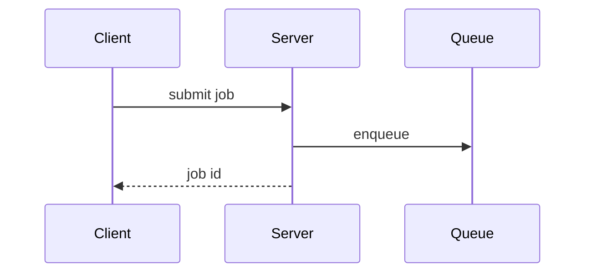
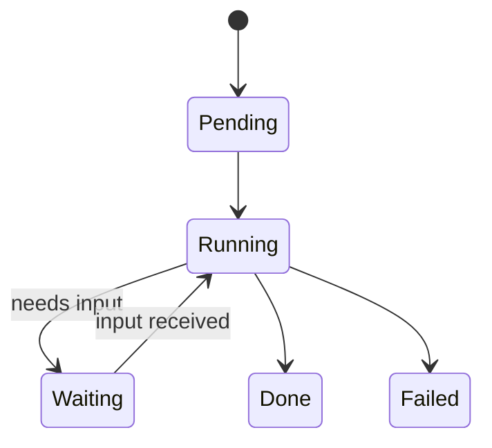

# Writing a PR description

Use the PR template the caller gives you, as given. Otherwise use the repository's own:
`.github/pull_request_template.md` or one under `.github/PULL_REQUEST_TEMPLATE/`. With no template,
use these headings: Why, Changes, Evidence, Merge risk. This skill covers how to fill in a template
well, not which headings it has. Write in the language the repo's template and history use.

## Before writing

- **Check for an existing PR.** Run `gh pr view <branch>` first. If the branch already has a PR,
  update it with `gh pr edit`; never open a second one for the same branch.
- **Write from the diff, not from memory.** Read `git diff <base>...HEAD` and check it against the
  goal. After several rounds of fixes, describe what the diff contains now, not what you remember
  doing.
- **Screen for secrets and private data.** Check the title, description, quoted logs and attached
  images for tokens, credentials, internal hostnames and personal details before sending.

## Principles

- **Write a specific title.** Name the problem solved or the outcome, not the activity: "Keep the
  cursor visible after a signal", not "Update select code". Follow the repo's title conventions, such
  as a commit-type prefix.
- **Lead with why.** State the problem or need in one to three sentences before describing the change.
- **Describe behaviour, not files.** Say what a user or the system now does differently. The diff
  already lists the files.
- **Show evidence.** Give a concrete before and after: a test that failed and now passes, command
  output, a screenshot. Do not restate the gates and CI checks; they are recorded elsewhere. Say what
  was not verified.
- **State the merge risk.** Ask what a revert would not undo once the change has run: data already
  written in a new format, clients or scripts that already depend on new behaviour, messages already
  sent, data deleted. Nothing means a two-way door. Anything means a one-way door: say exactly where
  rollback stops, and how to go through safely. A changed schema or CLI is not one-way by itself; it
  is when something has come to rely on it. Name the blast radius in a short phrase: what breaks if
  the PR is wrong.
- **Be brief.** Skip preambles. Use the project's own vocabulary, including its glossary if it has one.
- **Keep it accurate.** When later commits change the scope, update the title and description too.
- **List follow-ups at the end.** Put deferred work, such as review findings left for later, under a
  final "Follow-ups" heading as a checklist, one item per line. Update it on every new round of
  fixes: tick or drop what was done, add what was deferred.

## Filing

- **Draft or ready is the caller's choice.** If nobody says, open it ready so checks and bots run.
- **Fall back to REST when GraphQL is rate-limited.** Agents sharing one `gh` account often exhaust
  the GraphQL quota, which breaks `gh pr create`. Create the PR through REST instead:
  `gh api repos/<owner>/<repo>/pulls -f title=... -f head=<branch> -f base=<base> -F body=@<file>`.
  Use `gh api -X PATCH repos/<owner>/<repo>/pulls/<number>` the same way to update one.

## Sketching structural changes

A diff is ordered by file. It does not show execution order or where new code sits in a flow. A
sketch of a few lines gives the reviewer that picture before they read the diff.

Add a sketch only when the PR changes structure: control flow, call order, state transitions, module
layout, or how components communicate. Skip it for wording, styling, configuration values, or a
small local fix.

### Choosing a form

Use the smallest form that makes the point. One is usually enough; more than two is rarely needed.
Place the sketch next to the sentence it supports, and keep only the functions, files, states, and
boundaries that point needs. Use the names from the code.

| To show | Use |
| --- | --- |
| Logic, conditions, an algorithm | Pseudocode |
| Call order at runtime | Call tree |
| What each directory or module owns | File tree |
| How components exchange messages | Mermaid `sequenceDiagram` |
| States and transitions | Mermaid `stateDiagram-v2` |
| What changes, when the shape already exists | A `diff` of one of the above |

### Pseudocode

```text
on save
  if content is unchanged
    return cached result
  write new content
  return fresh result
```

### Call tree

```text
handleRequest
  authenticate
  loadOrder
    readCache
    readDatabase       # on cache miss
  renderResponse
```

### File tree

```text
src/
├── cli/        # parses commands
├── service/    # owns business rules
└── storage/    # reads and writes records
```

### Mermaid





### Diff of a sketch

Use a diff when the shape already exists and the point is what changes. Match the diff to the form.

```diff
 handleRequest
   authenticate
+  checkRateLimit
   loadOrder
   renderResponse
+    recordMetrics
```

```diff
 src/
 ├── cli/
 ├── service/
-└── storage.ts
+└── storage/
+    ├── reader.ts
+    └── writer.ts
```

```diff
 on save
-  write content
+  if content is unchanged
+    return cached result
+  write new content
```

### Showing code in full

Show the full block instead of a sketch when most of it is new, when trimming it would hide ordering
or ownership, or when the reviewer needs the exact shape, such as a new type, schema, or public
signature.

## Credits

Adapted from Matt Pocock's `pr` skill and Theo Browne's `file-pr` skill. The catalogue of sketches
comes from Dex Horthy's `show-me` skill (HumanLayer). See [NOTICE.md](../../NOTICE.md).
