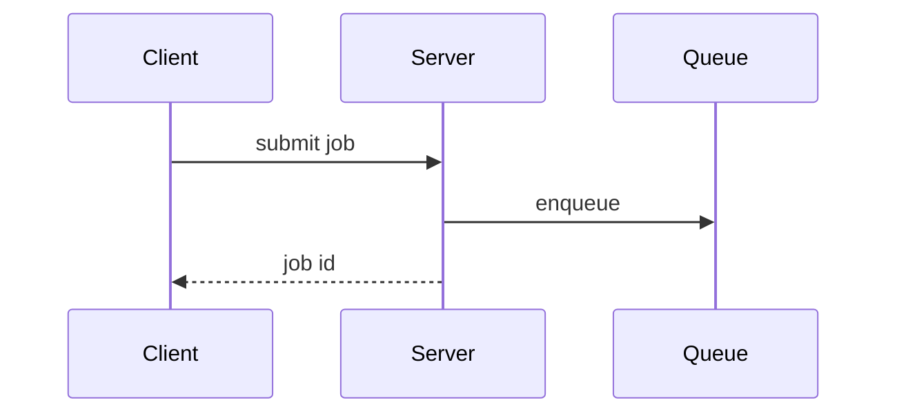
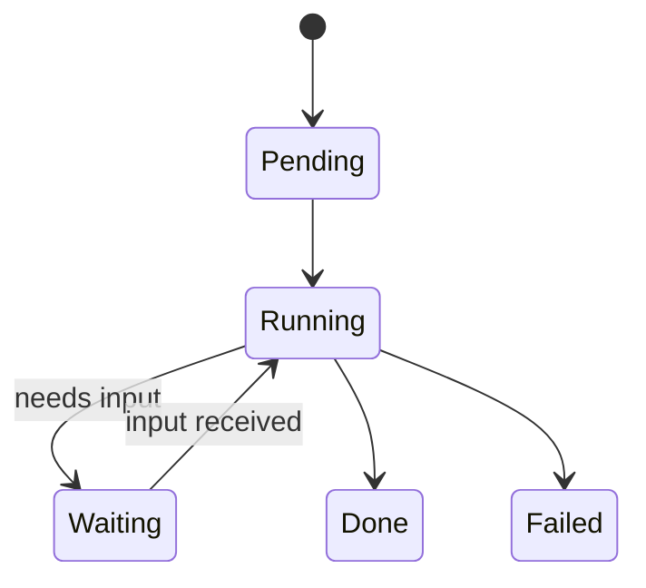

# Structural sketch examples

Read when a structural change needs more than the form-selection table.

### Pseudocode

```text
on save
  if content is unchanged
    return cached result
  write new content
  return fresh result
```

### Call tree

```text
handleRequest
  authenticate
  loadOrder
    readCache
    readDatabase       # on cache miss
  renderResponse
```

### File tree

```text
src/
├── cli/        # parses commands
├── service/    # owns business rules
└── storage/    # reads and writes records
```

### Mermaid





### Diff of a sketch

Use a diff when the shape already exists and the point is what changes. Match the diff to the form.

```diff
 handleRequest
   authenticate
+  checkRateLimit
   loadOrder
   renderResponse
+    recordMetrics
```

```diff
 src/
 ├── cli/
 ├── service/
-└── storage.ts
+└── storage/
+    ├── reader.ts
+    └── writer.ts
```

```diff
 on save
-  write content
+  if content is unchanged
+    return cached result
+  write new content
```

### Showing code in full

Show the full block instead of a sketch when most of it is new, when trimming it would hide ordering
or ownership, or when the reviewer needs the exact shape, such as a new type, schema, or public
signature.

